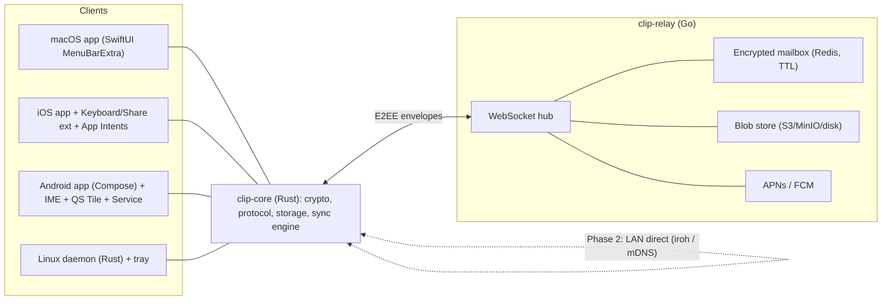
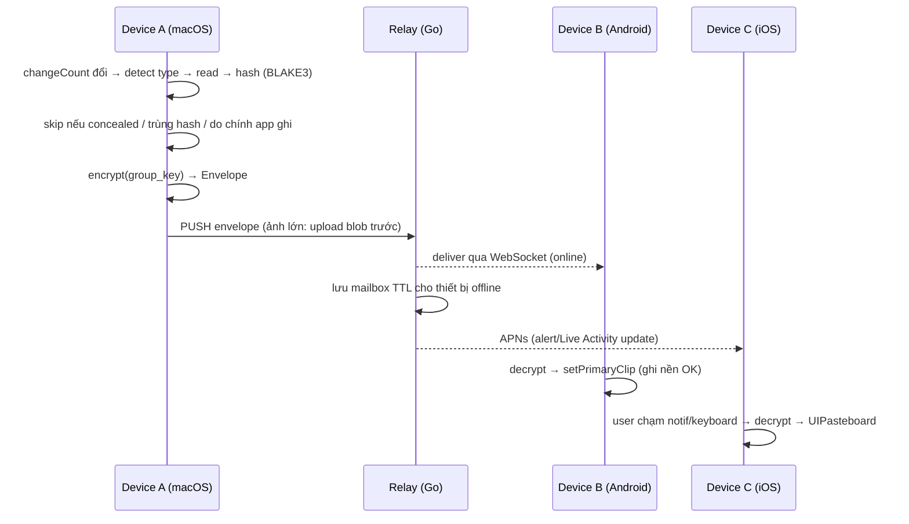

# ClipBridge — Architecture (Draft v0.1)

## 1. Tổng quan



## 2. Monorepo layout (dự kiến)

```
clipbridge/
├── core/                 # Rust workspace
│   ├── clip-core/        # domain, crypto, protocol, sqlite storage, sync engine
│   ├── clip-ffi/         # UniFFI bindings → Swift (XCFramework) & Kotlin (AAR)
│   └── clip-linux/       # Linux daemon: X11/Wayland watcher, tray, systemd unit
├── server/               # Go relay (Chi + WebSocket), Clean Architecture
├── apps/
│   ├── apple/            # Xcode multiplatform: iOS, macOS, KeyboardExt, ShareExt, Widgets
│   └── android/          # Gradle: app, ime, tile, service
├── docs/
└── scripts/              # build xcframework, cargo-ndk, release
```

## 3. Luồng dữ liệu



## 4. Domain model (clip-core)

| Entity | Trường chính |
|---|---|
| `Device` | `id (Ed25519 pubkey)`, `name`, `platform`, `push_token?`, `last_seen` |
| `Group` | `id`, `group_key (XChaCha20)`, `epoch` (rotate khi revoke device) |
| `ClipItem` | `id (ULID)`, `origin_device`, `kind (text/image)`, `mime`, `hash`, `size`, `created_at`, `lamport`, `payload or blob_ref`, `thumbnail?` |
| `Envelope` | `v`, `group_id`, `epoch`, `sender`, `nonce`, `ciphertext`, `sig` |

## 5. Platform adapters (interface chung)

```rust
/// Implemented natively per platform; core only depends on this trait.
pub trait ClipboardAdapter: Send + Sync {
    fn read(&self) -> Result<Option<ClipContent>, AdapterError>;
    fn write(&self, content: &ClipContent) -> Result<(), AdapterError>;
    fn subscribe(&self, sink: Box<dyn ClipboardSink>) -> Result<Subscription, AdapterError>;
}
```

| Platform | Watcher | Writer |
|---|---|---|
| macOS | Timer poll `changeCount` + detect API | `NSPasteboard.writeObjects` |
| Linux | XFixes / data-control events | Giữ selection ownership |
| Android | IME / Tile / Share (on-demand) | `ClipboardManager.setPrimaryClip` |
| iOS | Intent / Share ext / foreground read | Foreground hoặc extension |
